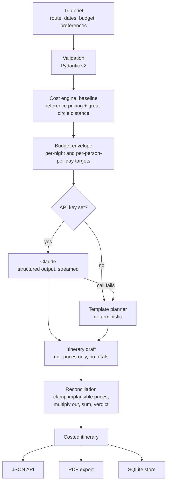

# WhereToNext

**An AI travel itinerary planner whose budgets actually add up.**

Give it a route, dates, a budget and your preferences. It returns a day-by-day
itinerary, a reconciled cost breakdown, and a PDF you can carry.

[](https://github.com/juhi57/WhereToNext/actions/workflows/ci.yml)


---

## The problem this solves

Ask any LLM to plan a trip on a budget and you get something that reads
beautifully and does not add up. Prices are invented, totals do not match the
line items, a six-day trip is billed for six hotel nights instead of five, and a
beachfront resort is quoted at ₹400 a night.

**WhereToNext never lets the language model do arithmetic.**

The model is used for what it is genuinely good at — choosing places, sequencing
a day, knowing that a particular viewpoint is best at dusk — and is asked only
for *unit* prices. Every total, percentage and verdict is computed by a
deterministic cost engine that also validates the model's unit prices against
reference data and corrects the implausible ones. Each correction is reported
back to the user rather than hidden.

> *Day 2 stay 'Ubud Jungle Resort': reduced ₹9,00,000 to ₹16,000 — the quoted
> price was implausibly high for this destination.*

That one design decision is what the rest of this codebase is built around.

---

## Quickstart

**No API key required.** The project ships a deterministic template planner so
it is fully usable the moment you clone it.

```bash
git clone https://github.com/juhi57/WhereToNext.git
cd WhereToNext
python -m venv .venv && source .venv/bin/activate   # Windows: .venv\Scripts\activate
pip install -e ".[dev]"
uvicorn app.main:app --reload
```

Open <http://127.0.0.1:8000>. Interactive API docs are at `/docs`.

To enable AI planning, add a key:

```bash
export ANTHROPIC_API_KEY=sk-ant-...     # Windows: $env:ANTHROPIC_API_KEY="sk-ant-..."
```

Or generate a plan and a PDF straight from the terminal:

```bash
wheretonext plan --from Mumbai --to "Bali, Indonesia" \
  --start 2026-12-13 --days 6 --budget 180000 \
  --food vegetarian --interests beaches,food,culture \
  --pdf itinerary.pdf
```

A generated example is committed at
[`docs/sample-itinerary.pdf`](docs/sample-itinerary.pdf).

---

## How it works



Both planners emit the **same draft shape**, so there is exactly one costing
path in the codebase and the template planner doubles as a free, deterministic
test fixture for it.

### The three stages of the cost engine

| Stage | What it does | Why |
|---|---|---|
| `baseline()` | Prices the trip from reference data alone | The yardstick everything is measured against |
| `envelope()` | Splits the budget into per-night / per-person-per-day targets written into the prompt | A model told "₹6,400 a night" plans a trip that costs that; one told "stay under ₹1,80,000" does not |
| `reconcile()` | Clamps outlier unit prices, multiplies to party totals, sums into six buckets, issues a verdict | The model's numbers are treated as *suggestions*, never as truth |

### What the reference model knows

- **160 destinations** with coordinates and price tiers (`very_cheap` → `very_expensive`), plus 68 country-level fallbacks for unlisted cities, in [`app/data/places.json`](app/data/places.json).
- **Great-circle distances** between city centroids, inflated by a per-mode detour factor — a road is never a straight line.
- **Mode feasibility**, so the planner never suggests taking a train from Mumbai to Bali.
- **Occupancy rules** — hostels are priced per bed, hotels per room, hire cars per vehicle.
- **Nights, not days** — a six-day trip is charged for five nights, and the departure-day stay is explicitly zeroed.

All of it is indicative, documented as such, and isolated behind two functions
so a live pricing API can replace it without touching anything else. See
[`docs/cost-model.md`](docs/cost-model.md).

---

## What it does


- **Full trip brief** — origin, destination, dates, party size, budget and
  currency, transport mode, stay tier, food preference, pace, interests,
  accessibility needs and free-text notes.
- **Instant budget check** (`POST /api/estimate`) — costs a trip with no model
  call at all, so a user learns their budget is unrealistic *before* waiting for
  a plan.
- **Quantified savings advice** when a plan overshoots — not "travel cheaply",
  but *"switch from mid hotel to budget hotel: saves about ₹9,600"*, ranked by
  how much each lever actually saves.
- **Day-by-day itinerary** with timed activities, dietary-aware meals,
  accommodation, local transport and booking tips.
- **PDF export** — a cover page with the verdict, a budget breakdown with
  proportion bars, the long-haul legs, a page per day, packing list, tips and
  warnings.
- **Eight currencies**, with correct Indian lakh/crore digit grouping (₹12,34,567,
  not ₹1,234,567).
- **Graceful degradation** — no key, a refusal, a timeout or a truncated
  response all fall back to the template planner with an honest label, never a
  500.

---

## API

| Method | Path | Purpose |
|---|---|---|
| `GET` | `/api/health` | Status, planner in use, cache statistics |
| `GET` | `/api/options` | Every enum and destination the UI needs |
| `POST` | `/api/estimate` | Cost a trip instantly, no model call |
| `POST` | `/api/itineraries` | Generate, cost and store a full itinerary |
| `GET` | `/api/itineraries` | List recent plans (paginated) |
| `GET` | `/api/itineraries/{id}` | Fetch one plan |
| `GET` | `/api/itineraries/{id}/pdf` | Download the PDF (`?inline=true` to preview) |
| `DELETE` | `/api/itineraries/{id}` | Delete a plan |

Errors use one envelope throughout, with a stable `code` to branch on:

```json
{
  "error": {
    "code": "validation_failed",
    "message": "The trip details are not valid.",
    "fields": [{ "field": "end_date", "message": "end_date must be on or after start_date" }]
  }
}
```

---

## Configuration

Every setting is an environment variable prefixed `WTN_`, with
`ANTHROPIC_API_KEY` also honoured under its conventional name. Copy
[`.env.example`](.env.example) to `.env`. The ones that matter:

| Variable | Default | Notes |
|---|---|---|
| `ANTHROPIC_API_KEY` | *(unset)* | Without it, the template planner is used |
| `WTN_ANTHROPIC_MODEL` | `claude-opus-5-5` | |
| `WTN_EFFORT` | `high` | Reasoning depth: `low` → `max` |
| `WTN_FORCE_HEURISTIC` | `false` | Skip the model even with a key, for demos and CI |
| `WTN_FALLBACK_TO_HEURISTIC` | `true` | Serve a template plan when the model fails |
| `WTN_DATABASE_URL` | `sqlite+aiosqlite:///./wheretonext.db` | Any async SQLAlchemy URL |
| `WTN_RATE_LIMIT_PER_MINUTE` | `10` | Applies to plan generation only |
| `WTN_CACHE_TTL_SECONDS` | `900` | Identical briefs are served from memory |

---

## Testing and quality

```bash
make check        # ruff + mypy + pytest, exactly what CI runs
make cov          # coverage report
```

**270 tests, 98% statement coverage.** The suite runs in a few seconds, makes no
network calls and spends nothing — the Anthropic client is stubbed, so every
failure mode (auth error, rate limit, timeout, refusal, truncated response,
unparseable output) is covered without an API key.

Things the tests deliberately pin down:

- Totals equal the sum of their parts, at the day level and the trip level.
- A six-day trip books five nights.
- A draft with *every* unit price poisoned still produces a sane total.
- Savings advice never suggests a train to an island.
- Evening activities are never scheduled in the morning.
- The PDF's **decompressed** content streams contain the expected text — a raw
  byte search over a compressed PDF passes no matter what was rendered.
- No rupee glyph reaches the PDF, because ReportLab's base-14 fonts have no
  `U+20B9` and would render an empty box.

CI runs lint, types and tests across Python 3.11–3.13 on Linux and Windows,
builds and probes the Docker image, and runs an end-to-end smoke test that
generates a real PDF without a key.

---

## Deployment

```bash
docker compose up --build        # http://localhost:8000
```

The image is a multi-stage build on `python:3.12-slim`, runs as an unprivileged
user, carries a healthcheck, and stores the database on a named volume.

---

## Design decisions

**The model never computes a total.** Keeping totals out of the response schema
means there is exactly one place in the codebase that can produce one, which is
also the only place that needs testing for it.

**The draft schema is separate from the final model.** `ItineraryDraft` is what
Claude fills in; `Itinerary` is what the user receives. The boundary is where
reconciliation happens, and it is explicit rather than implied.

**Structured outputs, not prose parsing.** The response shape is pinned by a
JSON Schema generated from the Pydantic model and validated by the SDK. There is
no regex anywhere near the model's output.

**Streaming.** A 30-day itinerary is a large response; a non-streaming request
with a high `max_tokens` risks an HTTP timeout.

**Prompt caching.** The system prompt is byte-identical on every request and
sits behind a cache breakpoint; everything trip-specific goes after it.

**The template planner is not a toy.** It exists so the repository runs for
anyone who clones it, so the suite is free and deterministic, and so an API
outage degrades instead of failing.

**One JSON column, not a dozen tables.** An itinerary is always read and written
whole and never queried by activity. The columns beside the blob exist only to
make the listing query cheap.

**Known limits, stated plainly:** pricing is indicative rather than live; the
rate limiter and cache are per-process and would move to Redis behind more than
one worker; there are no user accounts; the schema is created with
`create_all` rather than migrations.

---

## Project layout

```
app/
├── api/           # FastAPI routes and dependencies
├── core/          # cache, errors, logging, money, rate limiting
├── data/          # places.json: the reference dataset
├── models/        # TripRequest, ItineraryDraft (AI), Itinerary (final)
├── services/
│   ├── ai/        # Anthropic client and prompts
│   ├── budget.py  # the cost engine
│   ├── cost_data.py
│   ├── heuristic.py
│   ├── pdf.py
│   ├── planner_service.py
│   └── repository.py
├── web/           # single-page UI, no build step
├── cli.py
└── main.py
tests/             # 270 tests
```

---

## Built with

Python 3.11+ · FastAPI · Pydantic v2 · SQLAlchemy 2.0 (async) · Anthropic SDK
(Claude Opus 5.5) · ReportLab · pytest · Ruff · mypy · Docker

## License

[MIT](LICENSE)
